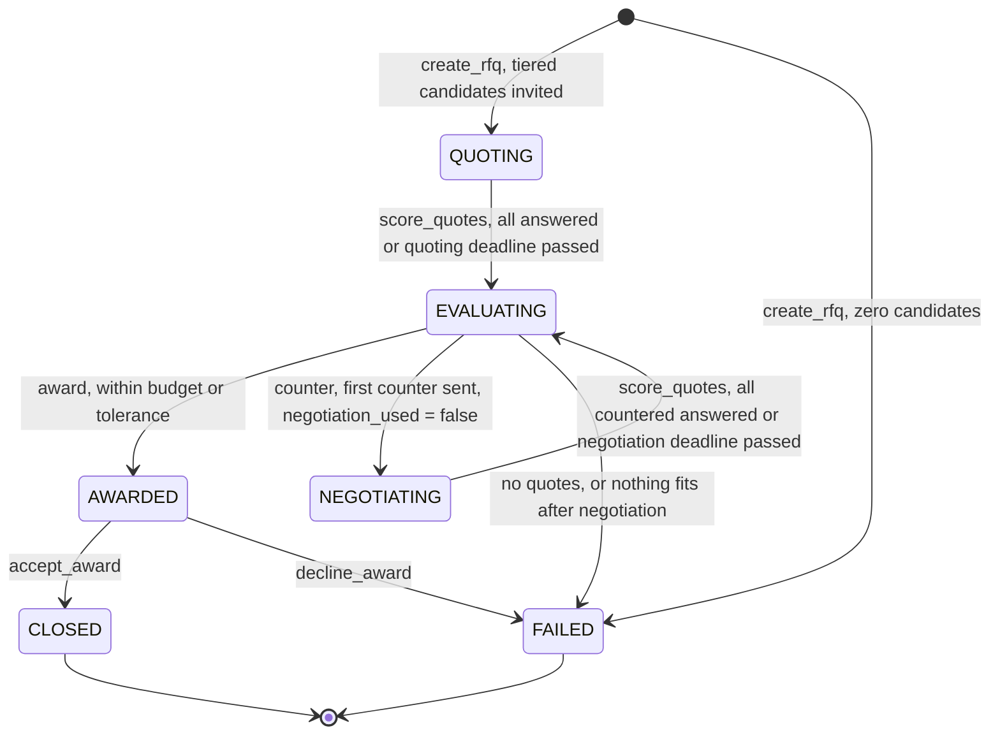
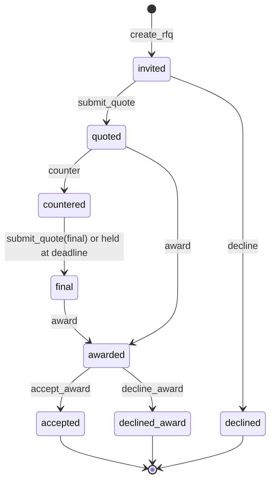
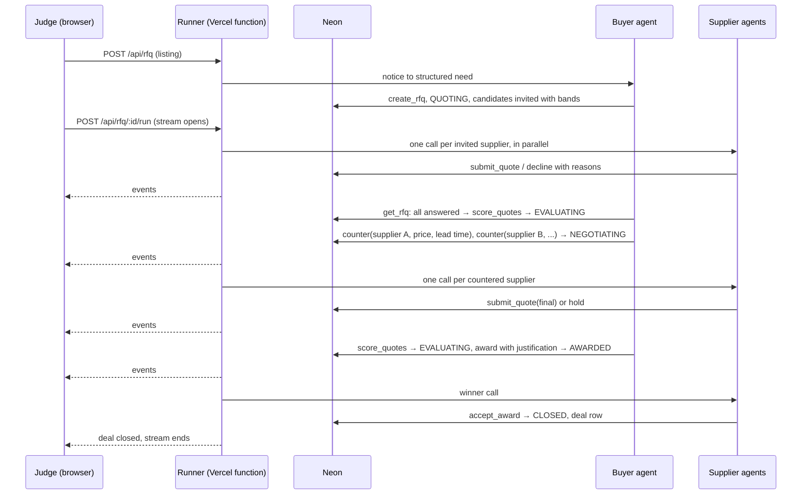

# Team Rocket — Agent Marketplace for the European Defence Supply Chain

Build the Arsenal · SalesPatriot Europe Challenge · Warsaw, 30 Oct 2026

## 1. The problem, in plain words

Europe is buying a lot of military and security equipment right now. The buying
happens through public tenders: a ministry, an army unit or NATO's procurement
agency publishes a notice ("we need 40 pitot probe covers by November",
"we need ballistic helmets, framework contract, 2 years"), companies read it, send
offers, and the buyer picks one.

Today that process runs on email, PDFs and portals in 24 languages. Three things go
wrong:

- **Fragmented.** Notices are spread across TED (EU wide), national platforms like
  e-Zamówienia (Poland), NATO NSPA, the European Defence Agency, and ministries'
  own sites. Nobody sees the whole market.
- **Manual.** Finding a supplier, getting a quote, comparing offers and awarding takes
  weeks of human work on both sides.
- **Missed.** A small Finnish drone shop that already won a drone tender in Helsinki
  never hears about the Polish one. Capacity sits idle while demand waits.

**What we build:** a marketplace that does three things.

1. **Matching.** For any open notice, which real companies could deliver it. For any
   company, which open notices fit its track record. This is instant, both ways.
2. **Negotiating.** A buyer agent turns a notice into a request for quotes, supplier
   agents (each representing a real company with a real history) quote or decline
   with reasons, the buyer counters each shortlisted supplier individually, they
   answer, the buyer awards with a justification, the winner accepts. No human in
   the loop.
3. **Enforcing.** The market itself is code: who may act when, what a supplier may
   see, what price it may quote. Agents decide inside those bounds. The server is a
   referee, never an orchestrator.

**Why this is credible and not a toy:** both sides come from real public data.
Demand = real open notices fetched today. Supply = real companies that have
actually won EU defence contracts, with what they won, where, and for how much.
No invented companies, no invented tenders.

**How we frame the deal on stage:** a public tender cannot legally be closed by two
agents today. What we show is the market as it looks when every company runs its own
agent. We seed those agents from the company's public award history. Say this up
front, the founder judging us knows procurement.

### What the judges require

| Must have | How we satisfy it |
|---|---|
| Live app on the host's computer, no slides | Deployed Vercel URL, live event feed; Claude Desktop connected to the same MCP endpoint |
| Real public European data | TED, NSPA, EDA, e-Zamówienia, Agencja Uzbrojenia notices; TED award winners; ECB FX rates. Fetch timestamp shown in the UI |
| Both market sides, one deal closed with no human | Buyer agent and supplier agents close an award through the server; acceptance writes a deal row |

Scoring: usefulness 30, creativity 30, use of data 20, demo quality 20. The
negotiation round is where creativity is won. It must happen on every run.

## 2. Data

### 2.1 What we have (`data_discovery/`)

Staging CSVs live in `data_discovery/data/raw/staging/` (gitignored, regenerated by
the fetch scripts). The committed common format is `data_discovery/data/processed/
market.db` (SQLite, TED only). The Neon loader starts from `market.db`.

| File | Rows | Role |
|---|---|---|
| `ted_notices.csv` | ~47k, 811 open | **Demand.** EU wide notices, CPV, deadlines, estimated values in EUR, clearance flag, lots |
| `ted_award_winners.csv` | ~38k | Raw award × winner rows |
| `suppliers.csv` | ~17k | **Supply, already deduplicated.** Name, country, registry id, size, award counts, top CPVs, total value, buyer countries |
| `supplier_awards.csv` | ~48k | Awards joined to the deduplicated supplier key |
| `nspa_notices.csv` | ~2.2k | **Demand.** NATO RFPs. No CPV, no value, no end buyer |
| `eda_notices.csv` | ~120 | **Demand.** EDA calls |
| `agencja_uzbrojenia_notices.csv` | ~340 | **Demand / context.** Polish Armament Agency |
| `ecb_fx_rates.csv` | 33 | Already applied: EUR columns exist. Kept for display |
| `eda_defence_data_*.csv` | ~3.9k | Context: national defence spend for the UI |

Supplier deduplication is done. Do not redo it.

### 2.2 Postgres schema, data side (Neon)

CPV (Common Procurement Vocabulary) is the EU classification of *what* is bought
(e.g. 35613000 = drones). It is the matching key and stays on listings and awards.
The identifier of a notice in its source system is `external_id` + `source_system`.

```
buyers          id, name, country, city, legal_type
suppliers       id, name, country, city, vat_id, size
identifiers     entity_type (buyer|supplier), entity_id, system, external_id
listings        id, source_system, external_id, url, buyer_id, main_cpv, cpv_codes,
                title, description, deadline, estimated_value_eur, n_lots, framework,
                security_clearance, eligibility (eu|nato|any), is_open, fetched_at
awards          id, source_system, external_id, buyer_id, supplier_id, cpv,
                value_eur, award_date, tenders_received
fx_rates        currency, units_per_eur, rate_date

supplier_stats  (view over awards) supplier_id, win_count, median_value_eur,
                min_value_eur, last_award_date, cpv_classes
```

Rules:

- Load from `market.db` into raw tables first, build entity tables and the view with
  SQL on top, keep the raw tables.
- Counts, medians, top CPV classes are never stored on `suppliers`; they come from
  `supplier_stats`. Materialise the view if the match query is slow.
- Corporate fields (city, VAT, size) are filled where TED has them and left null
  otherwise.
- TED only in Neon for the demo. Other sources stay in the discovery folder unless
  time remains.

### 2.3 Market side tables

```
rfqs        id, listing_id, buyer_id, state, need (json), budget_eur,
            budget_tolerance (numeric, e.g. 1.10), quoting_deadline,
            negotiation_deadline, negotiation_used (bool), awarded_quote_id,
            running (bool), created_at, updated_at
candidates  rfq_id, supplier_id, tier (1|2|3), price_low, price_high, price_floor,
            open_deals_in_cpv (int, computed at invitation),
            counter_price_eur, counter_lead_time_days, counter_message,
            status (invited|quoted|declined|countered|final|awarded|accepted|declined_award)
quotes      id, rfq_id, supplier_id, final (bool), price_eur, lead_time_days,
            note, score, rank, created_at
deals       id, rfq_id, quote_id, buyer_id, supplier_id, price_eur,
            lead_time_days, contract_summary, closed_at
events      id (bigserial cursor), rfq_id, actor, action, payload (json),
            state_before, state_after, ts
```

`events` is append only. The UI, Claude Desktop, the supplier responder and any
resumed run read from it.

## 3. Architecture (Vercel + Neon)

The repo is a Hono server (oRPC, Drizzle, Better Auth, MCP) deployed as a Vercel
function, plus a Vite + TanStack Router SPA. Not Next.js. The run route lives in the
Hono server.

```
+------------------+                    +----------------------------------+
| Browser (judge)  | --- POST run ----> |  Hono on Vercel (function)       |
|  listing page    | <== stream ======= |                                  |
|  match panel     |                    |  /api/listings/:id/matches       |      +--------------+
|  event feed      |                    |  /api/suppliers/:id/matches      | <--> | Neon         |
+------------------+                    |  /api/rfq            (create)    |      | Postgres     |
                                        |  /api/rfq/:id/run    (stream)    |      +--------------+
+------------------+                    |  /api/events?since=              |
| Claude Desktop   | --- MCP http ----> |  /api/mcp  (same tools)          |
| Claude Code      |                    |                                  |
+------------------+                    |  lib/tools.ts   the market       |
                                        |  lib/agents.ts  buyer + supplier |
                                        |  lib/run.ts     the runner       |
                                        +----------------------------------+
                                                       |
                                                       v  Anthropic API
```

Three layers, kept apart:

- **The market: database plus tools.** Fourteen functions in `lib/tools.ts`. They sit
  still until called. The state machine is not a process, it is the guards inside the
  functions. `award` refuses unless the RFQ is in EVALUATING. Nobody "runs" it.
- **The agents: prompt, model, tools.** The buyer agent decides when to stop waiting,
  whom to counter and with what, whom to award and why. Supplier agents decide
  whether to quote, at what price and lead time, and why. All judgement lives here.
- **The runner: the thing that presses go.** A model has no clock. In Claude Desktop a
  human types. On the server, `lib/run.ts` sends the buyer agent "look at the market
  and act" every few seconds, and answers each event addressed to a supplier with one
  supplier call. It knows nothing about procurement.

Principles:

- **Matching is a query.** No process, no waiting. `search_supply` for a listing and
  `search_demand` for a supplier return in under a second.
- **A round is one request.** `POST /api/rfq/:id/run` hosts the runner for one round
  and streams events to the browser. A round takes 30 to 90 s; Vercel Fluid Compute
  allows several minutes. The endpoint exists because a Vercel function only executes
  while a request is open. It is the compute context the agents live in, not an
  orchestrator.
- **The database is the only state.** After every action the new state is written.
  If the function dies, clicking run again resumes from the current state.
- **Every write checks state.** `UPDATE ... WHERE state = $expected`. Zero rows
  updated means the guard failed. A resumed run cannot double quote or double award.
- **One `running` flag** on the RFQ stops two tabs from running the same round.
- **Visibility is enforced in tools, not prompts.** A supplier calling `get_rfq` gets
  its own band, rank and counter, never another supplier's quote or floor. Rules
  between parties belong to the market, not to each party's prompt.
- **One tool module, two transports.** `lib/tools.ts` is called in-process by the
  agents and exposed over streamable HTTP at `/api/mcp` for Claude Desktop. A human
  in Claude Desktop can play any supplier with the same tools.
- **Code decides bounds, the model decides within bounds.** Filters, price bands,
  counter bounds, score formula and transitions are code. Reading a Polish notice,
  quote or decline, the counter to each supplier, award justification, accept or
  decline are the model.

### 3.1 The runner

```
POST /api/rfq/:id/run
  set running = true (fail if already running)
  open stream
  in parallel, until RFQ is CLOSED or FAILED, or the time budget (90 s) is spent:

    buyer loop:
      every 2 s: send the buyer agent "look at the market and act"
      it may make up to 8 tool calls per wake-up (get_rfq, get_events,
      score_quotes, counter, award)

    supplier responder:
      poll events since cursor
      for each event addressed to a supplier (invited, countered, awarded):
        one structured model call for that supplier, in parallel with the others
        validate the output (floor, phase), write it through submit_quote /
        decline / accept_award / decline_award

    push new events to the stream as they land
  set running = false
```

Supplier agents have no tool loop and no memory. Each decision is one model call
with structured output. The buyer is the only looping agent. This keeps the surface
small and the round predictable while the feed still shows supplier reasoning.

`MOCK_SUPPLIERS=1` replaces the supplier model call with code: quote at the middle
of the band, canned reason. For rehearsal and as the stage fallback only.

### 3.2 Notifications

Nobody waits, so nobody is notified. The browser holds the stream for the running
round and otherwise reads `/api/events?since=cursor` on page load. Claude Desktop
reads the same tables through MCP.

### 3.3 Later: always-on agents

If the round is stable with two hours left, the same runner can be started by a small
always-on process (Railway, Fly, or a laptop) that polls for RFQs not in a terminal
state. Then the browser only creates the RFQ and the agents notice on their own. The
agent code does not change, only who calls it.

## 4. MCP tools (`lib/tools.ts`)

### Read, any client

| Tool | Input | Returns |
|---|---|---|
| `search_demand` | cpv_prefix, countries[], text, open_only, limit | listings with budget EUR, deadline, eligibility |
| `search_supply` | listing_id or cpv_prefix, countries[], limit | tiered candidate suppliers with stats |
| `get_listing` | listing_id | notice + buyer + derived fields |
| `get_supplier` | supplier_id | profile + stats + past awards |
| `get_rfq` | rfq_id, as (buyer \| supplier_id) | state, need, deadlines; buyer sees all candidates, quotes, ranks; a supplier sees only its own band, status, rank, counter |
| `get_events` | rfq_id?, since, as | event rows filtered by the same visibility, new cursor |

### Buyer

| Tool | Input | Effect / guard |
|---|---|---|
| `create_rfq` | listing_id, need, quoting_deadline | RFQ in QUOTING; server runs tiered match, stores price band, floor and open deal count per candidate. Guard: listing open, ≥ 1 candidate else FAILED |
| `score_quotes` | rfq_id | ranks current quotes (final ones after negotiation). Pure code. Guard: QUOTING with every candidate answered or `quoting_deadline` passed → EVALUATING; or NEGOTIATING with every countered supplier answered or `negotiation_deadline` passed → EVALUATING |
| `counter` | rfq_id, supplier_id, price_eur, lead_time_days, message, negotiation_deadline | stores a counter on that candidate, state NEGOTIATING. Guards: EVALUATING, `negotiation_used` false (set true on first counter), supplier has quoted, once per supplier, price between 0.85 × and 1.0 × that supplier's own quote. No floor is checked, so nothing leaks |
| `award` | rfq_id, quote_id, justification | state AWARDED. Guards: EVALUATING, price ≤ budget, or price ≤ budget × tolerance with a justification. Non rank 1 requires justification |

### Supplier

| Tool | Input | Effect / guard |
|---|---|---|
| `submit_quote` | rfq_id, supplier_id, price_eur, lead_time_days, note, final | one per supplier per phase. Guards: QUOTING (final=false) or countered in NEGOTIATING (final=true), invited, price ≥ floor |
| `decline` | rfq_id, supplier_id, reason | status declined, reason visible to buyer. Guard: QUOTING |
| `accept_award` | rfq_id, supplier_id | CLOSED, deal row. Guard: AWARDED, caller is awardee |
| `decline_award` | rfq_id, supplier_id, reason | FAILED. Guard: AWARDED, caller is awardee |

Fourteen tools. In NEGOTIATING a countered supplier that does not answer by the
deadline has held, and its first quote stands.

## 5. State machine



### Candidate status per RFQ



### Guards

| Transition | Guard |
|---|---|
| create → QUOTING | ≥ 1 candidate from tiered match |
| QUOTING → EVALUATING | every candidate quoted or declined, or `quoting_deadline` passed. Buyer calls it |
| EVALUATING → NEGOTIATING | ≥ 2 quotes, `negotiation_used` false, buyer's choice |
| EVALUATING → AWARDED | price ≤ budget, or ≤ budget × tolerance with justification |
| EVALUATING → FAILED | no quotes, or nothing within tolerance and `negotiation_used` true |
| NEGOTIATING → EVALUATING | every countered supplier has a final quote, or `negotiation_deadline` passed. Buyer calls it |
| AWARDED → CLOSED | accept_award by the awardee |
| AWARDED → FAILED | decline_award by the awardee |

## 6. Workflows

### 6.1 The round



### 6.2 Matching (tiered query, pure SQL)

For a listing, candidates are suppliers with at least one award that passes:

| Tier | CPV | Country |
|---|---|---|
| 1 | same 3 digit class as listing main CPV | eligible for listing (`eu`, `nato`, `any`) |
| 2 | same 2 digit division | eligible |
| 3 | any division 35 (defence and security) | eligible |

Plus for every tier: if the listing requires security clearance, the supplier has
≥ 1 award under the defence directive; if the listing has a budget, the supplier's
median award value is between 0.2× and 5× that budget.

Order by tier, then win count in the matched CPV. Take 6. The same query with the
sides swapped gives a supplier its matching listings (`search_demand`). The supplier
page shows this: a supplier agent finding the notice itself is the fix for the
"missed" problem in the brief.

### 6.3 Pricing (supplier side)

Computed at invitation and stored on the candidate row:

- base = median award value for this supplier in the matched CPV, scaled to the
  listing budget when one exists (clipped to 0.5× to 1.5× budget)
- low / high = base × 0.85 / 1.15; small firms shift down 5 %, large up 5 %
- floor = minimum award value in the matched CPV × size margin
  (small 0.9, medium 0.85, large 0.8)
- open_deals_in_cpv = count of `deals` for this supplier in the matched CPV

The supplier agent picks a price inside [low, high]. `submit_quote` rejects anything
below floor.

### 6.4 Scoring (buyer side)

Fixed weights, three parts, 0 to 100:

| Part | Weight | Rule |
|---|---|---|
| price | 60 | lowest quote = 100, others scaled linearly |
| lead time | 25 | 100 if ≤ days to deadline, linear to 0 at 2× |
| track record | 15 | wins in matched CPV, log scaled, capped |

`score_quotes` returns the table. The buyer agent reads it and calls `counter` or
`award`. It may pick a non rank 1 quote with a written justification, which is logged.

### 6.5 Negotiation round (bilateral counters)

Defence procurement under Directive 2009/81/EC uses the negotiated procedure by
default: the buyer may negotiate with each bidder individually. We do exactly that,
once per RFQ.

1. After first quotes the buyer scores and picks a shortlist, usually the top three.
2. For each shortlisted supplier the buyer calls `counter` with a price, a lead time
   and a one line message. Code bounds the price to 85 to 100 % of that supplier's
   own quote. The cheapest bidder may be asked only for a shorter lead time. The slow
   expensive one may get no counter at all.
3. Each countered supplier sees only its own counter, its own rank and the number of
   bidders. Never another price. It answers once: accept the counter, improve on one
   dimension, or hold. Floor still applies. Not answering by the deadline means hold.
4. The buyer scores the finals and awards, within budget, or within tolerance with a
   justification. FAILED only if nothing fits even with tolerance.

Why this and not a broadcast "best and final offer": a broadcast target only fires
when quotes are over budget, which is rare with bands anchored to the budget, so the
negotiation would not appear on stage. Revealing the lowest price drives every
supplier to its floor in one step. And a floor based target guard leaks floors to the
buyer. Bilateral counters fire on every run, leak nothing, and show per supplier
reasoning in the feed.

Fallback if time runs short: a single `request_bafo(target)` broadcast, target
between 85 % of the lowest quote and the lowest quote, suppliers see target and own
rank only. One tool instead of per supplier counters.

### 6.6 Capacity, and accept or decline the award

Capacity is checked at the quote step, not at acceptance. The invitation carries the
supplier's open deal count in this CPV; the supplier prompt says decline with that
reason above two. A capacity decline is then visible early in the feed and a round
cannot fail after award.

The winner's agent is run once with the award details and decides:

- **Price sanity:** awarded price ≥ its floor (always true by construction).
- **Accept** writes the deal row and a contract summary. **Decline** → FAILED, kept
  only so the tool set is honest.

### 6.7 Decisions: code vs model

| Decision | Code | Model |
|---|---|---|
| Candidate tiers, filters, ordering | ✓ | |
| Price band and floor, FX | ✓ | |
| Counter price bounds | ✓ | |
| Score formula and ranks | ✓ | |
| State transitions, guards, visibility | ✓ | |
| Notice (any language) → structured need | | buyer |
| When to stop waiting and move the round | | buyer |
| Whom to counter, with what price, lead time, message | | buyer |
| Award choice and justification | | buyer |
| Quote or decline, with reason, given band, history, capacity | | supplier |
| Price inside band, lead time, note | | supplier |
| Answer a counter: accept, improve, or hold | | supplier |
| Accept or decline award | | supplier |

### 6.8 Agent shapes

| Agent | Shape | Tools | Budget |
|---|---|---|---|
| Buyer | tool loop, woken every 2 s by the runner | get_rfq, get_events, score_quotes, counter, award | 8 calls per wake-up, 90 s per round |
| Supplier | one structured call per event addressed to it | none; output is validated and written by code | 1 call per phase |

Supplier output schema:

```
{ action: quote | decline | accept_counter | improve | hold | accept_award | decline_award,
  price_eur?, lead_time_days?, reason }
```

## 7. Demo script (under 90 seconds)

1. Open the deployed URL. Click a real TED notice with a CPV and an estimated value
   (not NSPA: those have no CPV, no value, no end buyer). The match panel shows five
   real suppliers with their history and the fetch timestamp. Point at one: "won this
   CPV in Germany twice".
2. Click "Open RFQ". Feed: structured need in English next to the original title.
3. Click "Run". Feed: three quotes with reasoning, two declines with reasons (one for
   capacity), score table. Buyer counters two suppliers differently: the cheapest is
   asked for a shorter lead time, the second for a price cut.
4. Feed: one accepts the counter, one holds price but cuts lead time. Rescored. Buyer
   awards with a justification.
5. Feed: winner accepts. Deal card with contract summary.
6. Supplier page: pick a Finnish supplier, `search_demand` shows the Polish notice it
   would never have seen. One sentence on the "missed" problem.
7. Switch to Claude Desktop connected to `/api/mcp`: "which Polish suppliers could bid
   on this?" It calls `search_supply`. Same market, different client.
8. Fallback: a closed deal already in the DB from the morning rehearsal, replayed
   through the feed from the events table.

## 8. Build order and ownership

| Step | Deliverable | Owner |
|---|---|---|
| 1 | Neon schema, loader from `market.db`, buyers/suppliers/identifiers, `supplier_stats` view | data |
| 2 | `tools.ts` signatures with Zod inputs committed first; then tiered match, `search_supply`, `search_demand`, `get_listing`, `get_supplier` | server |
| 3 | `create_rfq` with bands and open deal counts, `submit_quote`, `decline`, `score_quotes` with deadline guard, `award`, `accept_award`, events, `get_rfq` visibility | server |
| 4 | Buyer loop (Anthropic TS SDK), supplier structured call, runner with streaming, `MOCK_SUPPLIERS` flag | agents |
| 5 | UI: listing page, match panel, event feed reading by cursor, deal card, run button, replay button | ui |
| 6 | **Checkpoint: one deal closed through the UI on the deployed URL.** Everyone stops for this if it is not there | all |
| 7 | `counter`, final quotes, negotiation deadline, buyer counter prompts | server + agents |
| 8 | Supplier page with `search_demand`; fetch timestamp badges | ui |
| 9 | `/api/mcp` read tools without OAuth or with a rehearsed login; Claude Desktop config | server |
| 10 | Seed 4 curated TED listings, rehearse three times, capture the fallback run | all |

Steps 1 to 6 are a working marketplace with a closed deal. Step 7 is the negotiation
beat. Step 9 is the protocol story.

Working rules: the tool module is the contract, nobody adds a tool without updating
the signatures first. The events table is the only integration point for the UI.
Deploy from hour one. Freeze features with one hour left.

## 9. Stack

- Hono server (oRPC, Drizzle, Better Auth, MCP) as a Vercel function, Fluid Compute,
  `maxDuration` set high on the run route
- Vite + TanStack Router SPA on Vercel
- Neon Postgres, pooled connection string (supplier calls run in parallel)
- Anthropic TypeScript SDK, a fast model, buyer loop capped per wake-up, suppliers as
  structured single calls
- `/api/mcp` streamable HTTP, already in the server
- Python scripts in `data_discovery/scripts/` stay as the offline data loaders
- No payments, no live scraping on stage. The existing auth and organisation
  scaffold stays out of every route a judge can reach

## 10. Risks

- **Cold starts.** Vercel functions and Neon compute both sleep when idle. Hit the
  site two minutes before going on stage.
- **Slow agents.** Fast model, buyer call cap, suppliers in parallel. A round must
  finish in under 90 s; if it does not in rehearsal, cut supplier count to 4, then
  flip `MOCK_SUPPLIERS`.
- **Negotiation never fires.** Fixed by design: the buyer may counter whenever two or
  more quotes exist. Rehearse that the buyer prompt actually does.
- **No candidates for the chosen listing.** Seed 4 TED listings known to have ≥ 3
  tier 1 candidates and a budget.
- **NSPA listings break matching.** No CPV, no value. Keep them out of the demo path
  or have the buyer agent infer a CPV from the title.
- **Supply dominated by Romanian medical suppliers (CPV 33).** Restrict supply to
  suppliers with ≥ 1 award in division 35 for the demo.
- **MCP requires OAuth.** The Claude Desktop beat needs either a rehearsed login or an
  unauthenticated read-only path for the six read tools. Decide in the first ten
  minutes.
- **Multilingual notices.** The buyer agent writes the need in English; the feed keeps
  the original title visible.

## 11. Deliberately left out

Supplier tool loops and supplier memory across deals, always-on agent host, broadcast
BAFO (kept only as the fallback), relaxing terms and reposting, widening as rounds,
awardee decline fallthrough, per constraint compliance vectors, per RFQ scoring
weights, supplier watchlists, consortium teaming, e-Zamówienia in Neon. Each was cut
because the judge never sees it in 90 seconds or because it adds a failure mode on
stage. First to add back if time remains: supplier memory (own past quotes and
outcomes in this market as prompt context, one query on `events`), then the always-on
host.
