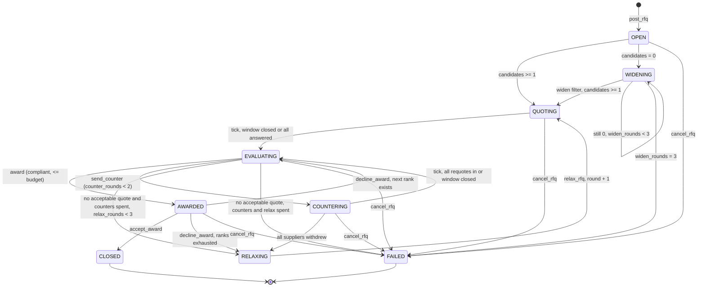
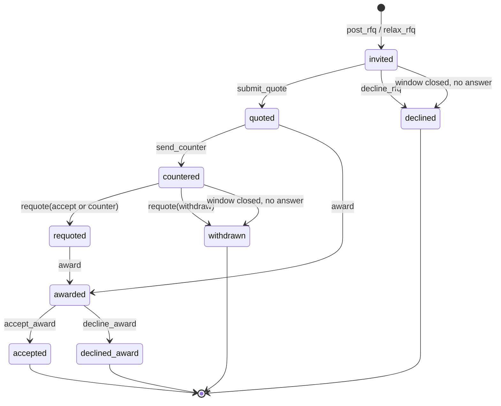
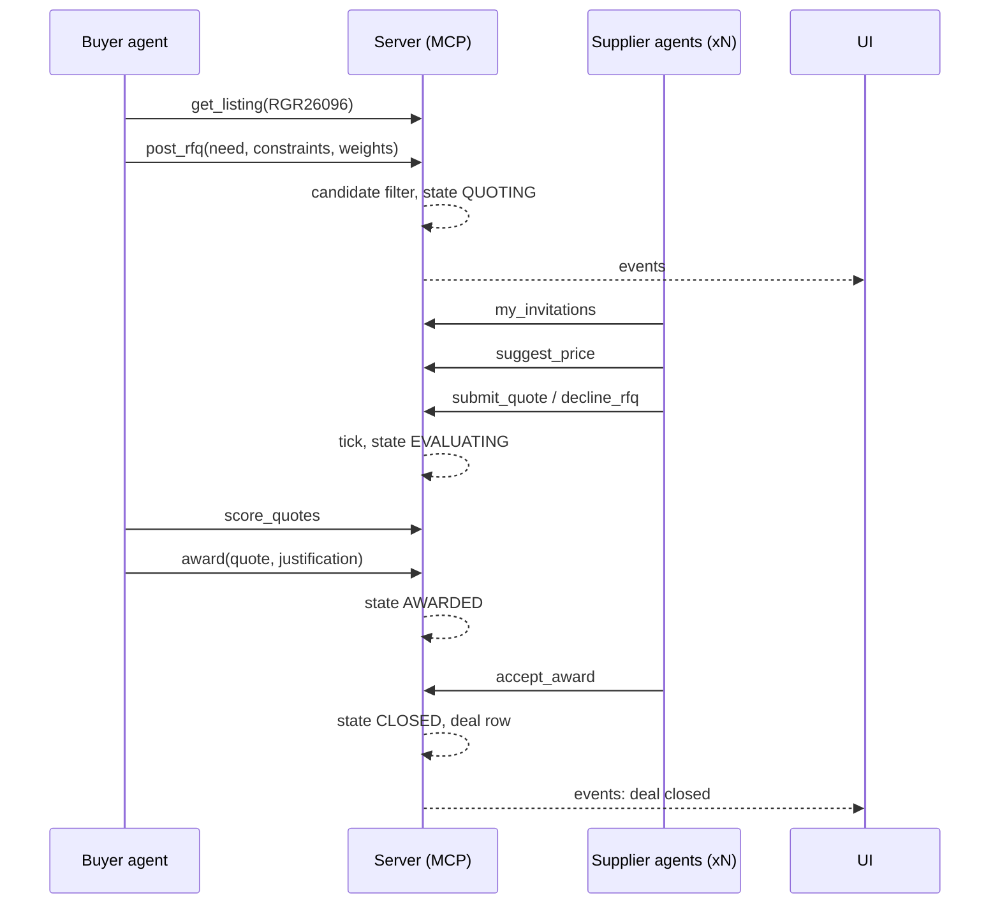

# Team Rocket — Agent Marketplace for the European Defence Supply Chain

Build the Arsenal · SalesPatriot Europe Challenge · Warsaw, 30 Oct 2026

## 1. The problem, in plain words

Europe is buying a lot of military and security equipment right now. The buying
happens through public tenders: a ministry, an army unit or NATO's procurement
agency publishes a notice ("we need 40 pitot probe covers by November",
"we need ballistic helmets, framework contract, 2 years"), companies read it, send
offers, and the buyer picks one.

Today that process runs on email, PDFs and portals in 24 languages. Three things go
wrong:

- **Fragmented.** Notices are spread across TED (EU wide), national platforms like
  e-Zamówienia (Poland), NATO NSPA, the European Defence Agency, and ministries'
  own sites. Nobody sees the whole market.
- **Manual.** Finding a supplier, getting a quote, comparing offers and awarding takes
  weeks of human work on both sides.
- **Missed.** A small Finnish drone shop that already won a drone tender in Helsinki
  never hears about the Polish one. Capacity sits idle while demand waits.

**What we build:** a marketplace where software agents do this work. A buyer agent
reads a real notice and asks the market for quotes. Supplier agents, each
representing a real company with a real track record, decide whether to bid, price
the job, negotiate, and accept the award. The whole loop from notice to signed deal
runs with no human in it.

**Why this is credible and not a toy:** both sides come from real public data.
Demand = real open notices we fetched today. Supply = real companies that have
actually won EU defence contracts, with their real history (what they won, where,
for how much). No invented companies, no invented tenders.

### What the judges require

| Must have | How we satisfy it |
|---|---|
| Live app on the host's computer, no slides | Local web UI showing the live event feed, plus Claude Desktop connected to the same MCP server |
| Real public European data | TED, NSPA, EDA, e-Zamówienia, Agencja Uzbrojenia notices; TED award winners; ECB FX rates |
| Both market sides, one deal closed with no human | Buyer agent + supplier agents close an award through the server; acceptance is logged as a deal |

Scoring: usefulness 30, creativity 30, use of data 20, demo quality 20.

## 2. Data we already have (`data/processed/`)

| File | Rows | Role in the market |
|---|---|---|
| `ted_notices.csv` | ~47k, 811 open | **Demand.** EU wide notices, CPV codes, deadlines, estimated values, security clearance flag, lots |
| `ted_award_winners.csv` | ~38k | **Supply.** Who won what: winner name, country, size, CPV, value in EUR, tenders received |
| `nspa_notices.csv` | ~2.2k | **Demand.** NATO RFPs, NATO member eligibility |
| `eda_notices.csv` | ~120 | **Demand.** EDA calls |
| `agencja_uzbrojenia_notices.csv` | ~340 | **Demand / context.** Polish Armament Agency news and contracts |
| `ecb_fx_rates.csv` | 33 | Normalise every price to EUR |
| `eda_defence_data_*.csv` | ~3.9k | Context: national defence spend, for the UI and for buyer budgets |

Supplier profiles are derived by grouping `ted_award_winners.csv` by winner name:
country, size, CPV classes won, buyer countries served, win count, median deal
value in EUR, last win date, list of past award ids. Each profile becomes one
supplier agent's identity.

## 3. Architecture

```
+----------------+   MCP (stdio/http)   +-----------------------------+
| Buyer agent    | -------------------> |                             |
+----------------+                      |   Marketplace MCP server    |     +-----------+
+----------------+                      |   (FastMCP, Python)         | <-- | SQLite    |
| Supplier       | -------------------> |                             |     | market.db |
| agents (xN)    |                      |   tools + tick + events     |     +-----------+
+----------------+                      +--------------+--------------+
+----------------+                                     | get_events (cursor)
| Claude         | -------------------> same server    |
| Desktop / Code |   (on stage demo)                   v
+----------------+                      +-----------------------------+
+----------------+  run_round(listing)  | Web UI: live feed, deals    |
| Orchestrator   | -------------------> | (FastAPI + HTML polling)    |
+----------------+                      +-----------------------------+
```

Principles:

- **The server is the only state.** Agents hold nothing in memory they cannot rebuild
  from `get_rfq` and `get_events`. A crashed agent restarts and continues.
- **Agents talk only to the market, never to each other.** Negotiation is structured
  objects (counter, requote) through the server, not free chat.
- **Code decides bounds, the model decides within bounds.** Filters, price bands,
  scoring formula, retry budgets and state transitions are code. Reading a messy
  Polish notice, bid/no bid, picking a price, choosing a negotiation lever and
  writing a justification are the model.
- **One tool surface for everyone.** The same MCP server serves our agents and
  Claude Desktop on stage ("find Polish suppliers who could bid on RGR26096").

### 3.1 Database (SQLite, `market.db`)

```
listings     id, source, source_id, url, buyer_name, buyer_country, main_cpv, cpv_codes,
             title, description, deadline, estimated_value_eur, n_lots, framework,
             security_clearance, eligibility (eu|nato|any), is_open
suppliers    id, name, country, size, cpv_classes (json), buyer_countries (json),
             win_count, median_value_eur, min_value_eur, last_win_date
awards       id, supplier_id, listing_source_id, cpv, value_eur, buyer_country, date
fx_rates     currency, units_per_eur, rate_date

rfqs         id, listing_id, buyer_agent, state, round, counter_rounds_used,
             relax_rounds_used, widen_rounds_used, need (json), constraints (json),
             weights (json), budget_eur, deadline, quote_window_ends_at,
             awarded_quote_id, created_at, updated_at
candidates   rfq_id, supplier_id, round_invited, substate
             (invited|quoted|declined|countered|requoted|withdrawn|awarded|accepted|declined_award)
quotes       id, rfq_id, supplier_id, round, price_eur, lead_time_days,
             compliance (json), references (json), note, score, rank, created_at
counters     id, rfq_id, round, target_price_eur, target_lead_time, scope_change, message
deals        id, rfq_id, quote_id, supplier_id, buyer_name, price_eur, lead_time_days,
             rounds, contract_summary, closed_at
events       id (autoinc cursor), rfq_id, round, actor, tool, payload (json),
             state_before, state_after, ts
```

`events` is append only. Everything the UI shows and everything an agent needs to
resume comes from it.

### 3.2 Tick: how the market advances

The server does nothing on its own. The orchestrator calls `tick(rfq_id)` after every
batch of agent actions. `tick`:

1. Closes the quote window if it expired or every candidate has answered.
2. Evaluates the transition guards for the current state (section 6).
3. Applies any code only transition (QUOTING to EVALUATING, OPEN to WIDENING, etc.).
4. Returns `next_action`: who must act and with which tool, e.g.
   `{"actor": "buyer", "tool": "score_quotes"}` or
   `{"actor": "suppliers", "ids": [...], "tool": "requote"}` or `{"actor": "none", "state": "CLOSED"}`.

Quote windows are seconds in the demo (configurable), days in reality.

### 3.3 How clients get notified

No push. Two pull mechanisms, both cheap:

- **Agents** are woken by the orchestrator based on `tick.next_action`. A supplier
  agent that wants to be proactive calls `my_invitations(supplier_id)` which returns
  every open RFQ it is a candidate for.
- **UI** polls `get_events(since=cursor)` every second and appends rows. The cursor
  is the autoincrement id, so it never misses or duplicates.

Claude Desktop on stage is just another client calling the read tools.

### 3.4 Orchestrator (`run_round.py`)

```
rfq = buyer.post_rfq(listing)                      # model builds the structured need
loop:
    act = server.tick(rfq)
    match act.actor:
        "suppliers": asyncio.gather(supplier_agent(id, act.tool) for id in act.ids)
        "buyer":     buyer_agent(act.tool)
        "none":      break
```

Every agent run is capped at ~5 tool calls. Supplier agents run in parallel.

## 4. Objects

| Object | Built from | Key fields |
|---|---|---|
| Listing | open notice | buyer, country, CPV, title, deadline, budget EUR, lots, clearance, eligibility |
| Supplier | TED winners grouped by name | country, size, CPV classes, countries served, win count, median deal EUR, past awards |
| RFQ | buyer agent reads a listing | structured need in English, constraints, weights, window, round |
| Quote | supplier agent answers an RFQ | price EUR, lead time, compliance per constraint, references, note |
| Counter | buyer after evaluation | target price, target lead time, scope change, message |
| Deal | award + acceptance | supplier, final price, lead time, rounds, contract summary |

## 5. MCP tools

### Read only (any client)

| Tool | Input | Returns |
|---|---|---|
| `search_demand` | cpv_prefix, countries[], text, open_only, limit | listings with budget EUR, deadline, eligibility |
| `get_listing` | listing_id | full notice + derived fields |
| `search_supply` | cpv_prefix, countries[], min_wins, size | supplier profiles |
| `get_supplier` | supplier_id | profile + past awards |
| `get_rfq` | rfq_id | RFQ, state, round, quotes visible to caller, candidate substates |
| `get_events` | rfq_id?, since_cursor | event rows, new cursor |

### Buyer

| Tool | Input | Effect / guard |
|---|---|---|
| `post_rfq` | listing_id, need, constraints, weights, quote_window_s | creates RFQ (OPEN), runs candidate filter, invites. Guard: listing is open |
| `score_quotes` | rfq_id | MEAT scores + ranks for current round, pure code. Guard: EVALUATING |
| `send_counter` | rfq_id, target_price_eur, target_lead_time?, scope_change?, message | opens COUNTERING. Guards: EVALUATING, counter_rounds_used < 2, at least 1 active supplier, target >= max(lowest quote, 0.7 x that supplier's quote) |
| `relax_rfq` | rfq_id, lever (deadline, budget, lots), value | reposts round+1. Guards: EVALUATING or no quotes, relax_rounds_used < 3, budget raise <= +25% |
| `award` | rfq_id, quote_id, justification | AWARDED. Guards: EVALUATING, quote compliant and <= budget. Non rank 1 requires justification |
| `cancel_rfq` | rfq_id, reason | FAILED from any non terminal state |

### Supplier

| Tool | Input | Effect / guard |
|---|---|---|
| `my_invitations` | supplier_id | open RFQs where this supplier is a candidate and window open |
| `suggest_price` | supplier_id, rfq_id | band {low, high, floor} from own award history in this CPV, FX normalised, scaled to listing budget |
| `submit_quote` | rfq_id, supplier_id, price_eur, lead_time_days, compliance, references, note | one per supplier per round. Guards: QUOTING, invited, within round, price >= floor |
| `decline_rfq` | rfq_id, supplier_id, reason | substate declined, reason stored for buyer |
| `requote` | rfq_id, supplier_id, move (accept, counter, withdraw), price_eur?, lead_time_days?, scope? | Guards: COUNTERING, substate countered, price >= floor |
| `accept_award` | rfq_id, supplier_id | CLOSED, deal row written. Guard: AWARDED and this supplier is the awardee |
| `decline_award` | rfq_id, supplier_id, reason | awardee out; buyer falls to next rank |

### Orchestrator

| Tool | Effect |
|---|---|
| `tick` | closes windows, applies code transitions, returns `next_action` |
| `seed_demo` | loads 4 curated listings + their candidate suppliers so the stage round is deterministic |

Every mutating call carries `rfq_id` and `round`. Wrong round is rejected. Duplicate
quote per (rfq, supplier, round) is rejected. This makes retries idempotent.

## 6. State machine



### Transition guards (enforced by the server)

| From, To | Guard |
|---|---|
| OPEN, QUOTING | at least 1 candidate after hard filter |
| OPEN, WIDENING | 0 candidates |
| WIDENING, QUOTING | after widening one notch: CPV class to division to any 35xx; countries buyer's to EU/NATO to any; capacity band x2 |
| QUOTING, EVALUATING | `tick` sees window expired or every candidate quoted/declined |
| EVALUATING, AWARDED | chosen quote compliant on all hard constraints and price <= budget |
| EVALUATING, COUNTERING | at least 1 supplier in substate quoted/requoted, counter_rounds_used < 2 |
| EVALUATING, RELAXING | no awardable quote, counter_rounds_used = 2 (or no suppliers to counter), relax_rounds_used < 3 |
| COUNTERING, EVALUATING | all countered suppliers requoted/withdrew, or window closed |
| AWARDED, CLOSED | `accept_award` by the awardee |
| AWARDED, EVALUATING | awardee declined, another compliant quote remains |

### Candidate (supplier) substate per RFQ



`declined`, `withdrawn` and `declined_award` are sticky for the rest of the RFQ. A
`relax_rfq` re-invites only suppliers that are not sticky, plus any new ones the
relaxed filter admits.

## 7. Workflows

### 7.1 Happy path (the deal we show first)



### 7.2 Matching (candidate filter, pure SQL)

Hard filters, applied in order:

1. CPV: supplier has won in the same 3 digit class as the listing's main CPV.
2. Eligibility: listing `eu` means supplier country in EU/EEA; `nato` means NATO member; `any` means no filter.
3. Clearance: if listing requires security clearance, supplier must have at least 1 past award with a defence directive buyer.
4. Capacity: supplier median past deal between 0.2x and 5x listing budget (skip if budget unknown).
5. Rank by win count in that class, cap at 6.

Widening (section 6) relaxes 1, 2 and 4 one notch per WIDENING round.

### 7.3 Pricing (supplier side)

`suggest_price` returns `{low, high, floor}`:

- base = median `value_eur` of this supplier's past awards in the class, scaled to the
  listing budget when one exists (clip to 0.5x to 1.5x budget)
- low/high = base x (0.85, 1.15); small firms shift down 5%, large up 5%
- floor = min past value in class x size margin (small 0.9, medium 0.85, large 0.8)

Model picks within [low, high], never below floor. The server rejects anything below.

### 7.4 Evaluation (buyer side, MEAT)

`score_quotes` returns 0 to 100 per quote using RFQ weights (default 50/20/20/10):

- price: lowest compliant = 100, others scaled down linearly
- lead time: 100 if <= deadline, linear penalty after, 0 at 2x deadline
- past performance: wins in this class, capped, log scaled
- familiarity: has served this buyer country before (100/0)

Non compliant quotes get score 0 and are flagged. Model reads the table, may skip a
quote with a reason, calls `award`.

### 7.5 Negotiation (counter round)

Triggered by code when: best compliant quote > budget, or misses the deadline, or only
one compliant quote exists (optional). Then:

1. Buyer `send_counter` with target inside [max(lowest quote, 0.7 x supplier quote), budget].
2. Server fans out to active suppliers with an anonymised field summary
   (n quotes, lowest, median) and the supplier's own rank.
3. Each supplier `requote`: accept target, counter above target, or withdraw. Floor enforced.
   Suppliers can trade on lead time or scope instead of price.
4. Buyer `score_quotes` again, then award or one more counter. Max 2 counter rounds.

### 7.6 Retries

| Failure | Owner | Action |
|---|---|---|
| 0 candidates | code | widen filter one notch, max 3 |
| candidates, all declined | buyer model | read decline reasons, pick lever: extend deadline / raise budget <= 25% / split lots, then `relax_rfq`, max 3 |
| quotes, none acceptable | buyer model | `send_counter`, max 2, then relax |
| awardee declines | code + buyer | award next rank, else relax |
| agent crash | orchestrator | re-run agent; it reads `get_rfq` and continues; duplicate calls rejected by round check |
| 3 relax rounds spent | code | FAILED with reason in events |

### 7.7 Supplier driven flow (stretch)

Same filter run from the other side. Supplier agent calls `search_demand` with its
own CPV classes and countries, registers interest with `watch_listing`, and is
auto-invited when an RFQ posts for that listing.

### 7.8 Teaming (stretch)

If a listing has several lots and no candidate covers all of them, `propose_team`
pairs two suppliers with complementary classes (using co-winner data from TED) and
they quote jointly.

## 8. What the model decides vs what code decides

| Decision | Code | Model |
|---|---|---|
| Candidate filter, widening | yes | |
| Price band, floor, FX | yes | |
| Score formula, ranks | yes | |
| State transitions, retry budgets, round checks | yes | |
| Notice (any language) to structured RFQ | | buyer |
| Weights for this RFQ | | buyer |
| Bid / no bid with reason | | supplier |
| Price inside band, lead time, references | | supplier |
| Counter or award; target price; message | | buyer |
| Accept / counter / withdraw; which lever (price, lead time, scope) | | supplier |
| Award justification, skipping a quote | | buyer |
| Which relaxation lever after no bids | | buyer |
| Accept or decline an award (capacity rule in prompt) | | supplier |

## 9. Demo script (under 90 seconds)

1. UI open, empty feed. Click "Run market round" on a real NSPA RFP.
2. Feed: RFQ posted (English structured need from the original notice), 5 suppliers invited.
3. Feed: 3 quotes, 2 declines with reasons. Scores table appears.
4. Feed: best quote over budget, buyer counters. One supplier holds price but cuts lead time, one accepts target, one withdraws.
5. Feed: award with justification, supplier accepts, DEAL CLOSED card with contract summary.
6. Switch to Claude Desktop connected to the same server: "which Polish suppliers could bid on this?" It calls `search_supply`. Same market, different client.
7. Fallback: `seed_demo` has already produced one closed deal in the DB before we go up.

## 10. Build order and ownership

| Step | Deliverable | Owner |
|---|---|---|
| 1 | Schema, loader from CSVs, supplier profile builder, FX normalisation | data |
| 2 | Read tools: `search_demand`, `search_supply`, `get_listing`, `get_supplier` | server |
| 3 | `post_rfq` + candidate filter, `submit_quote`, `score_quotes`, `award`, `accept_award`, `tick`, events | server |
| 4 | Buyer agent + supplier agent (Anthropic SDK tool loop), orchestrator `run_round.py` | agents |
| 5 | UI: event feed, scores table, deal card, run button | ui |
| 6 | `decline_rfq`, `relax_rfq`, WIDENING | server + agents |
| 7 | `send_counter`, `requote` | server + agents |
| 8 | `decline_award` fallthrough, `cancel_rfq`, `seed_demo` | server |
| 9 | Claude Desktop config pointing at the server; rehearse | all |

Steps 1 to 5 are a working marketplace with a closed deal. Everything after is score.

## 11. Stack

- Python 3.12, FastMCP for the server, SQLite via stdlib
- Anthropic SDK tool loop for agents; a fast model, each agent capped at ~5 tool calls
- FastAPI + one HTML page polling `/events` for the UI
- No auth, no payments, no live scraping on stage: fetch in the morning, serve from SQLite

## 12. Risks

- Slow or chatty agents on stage: fast model, tool call cap, short quote windows, pre-seeded fallback deal.
- Candidate filter returns nothing for the chosen listing: curate 4 listings in `seed_demo` that are known to have at least 3 candidates.
- Supplier profiles dominated by Romanian medical suppliers (CPV 33): restrict supply to winners with at least 1 award in CPV 35 for the demo.
- Multilingual notices: model builds the RFQ in English; keep the original title visible in the feed.
